# TURNEX — UML Class Diagram

Domain class diagram derived from the current Eloquent models, backed enums, the application services and the components that handle incoming requests. The responsibility, attributes, operations and relationships of every class are documented in the [class dictionary](class-dictionary.md).

Helper-only and boundary classes (for example `App\Services\DataNormalizer`, `App\Support\DataNormalizer`, notifications, rules and concerns) are intentionally excluded.

The document is split into two views so the dependency arrows stay readable:

- **Domain and service layer** — models, enumerations and the services that orchestrate them.
- **Presentation layer** — the component acting as controller for each route and the service it delegates to.

## Domain and service layer

Services depend on the domain models in the middle, which in turn reference the enumerations on the right. Dependencies always run in the same direction so the arrows stay short and readable.

```mermaid
classDiagram
    direction LR

    %% =========================================================
    %% Authentication base
    %% =========================================================

    class Authenticatable {
        <<abstract>>
    }

    %% =========================================================
    %% Domain models
    %% =========================================================

    class Business {
        <<Entity>>
        +int id
        +int reviewed_by
        +PersonType person_type
        +string tax_id
        +string dv
        +string business_name
        +string slug
        +BusinessCategory business_category
        +string owner_first_name
        +string owner_middle_name
        +string owner_last_name
        +string owner_second_last_name
        +string email
        +string phone_number
        +string location
        +string logo_path
        +string cover_photo_path
        +string business_description
        +VerificationStatus verification_status
        +string rejection_reason
        +datetime email_verified_at
        +datetime phone_verified_at
        +string password
        +string remember_token
        +datetime reviewed_at
        +datetime created_at
        +datetime updated_at
        +generateUniqueSlug(string name, int excludeId) string
        +reviewer() BelongsTo
        +offerings() HasMany
        +ownerFullName() string
        +hasVerifiedPhone() bool
        +hasVerifiedEmail() bool
        +isPendingVerification() bool
        +isUnderReview() bool
        +isApproved() bool
        +isActionRequired() bool
        +isRejected() bool
        +isNaturalPerson() bool
        +isLegalEntity() bool
        +formattedTaxId() string
        +initials() string
        -casts() array
        -booted() void
    }

    class Category {
        <<Entity>>
        +int id
        +string name
        +string description
        +bool is_active
        +datetime deleted_at
        +datetime created_at
        +datetime updated_at
        +scopeActive(Builder query) void
        +offerings() HasMany
        -casts() array
    }

    class Customer {
        <<Entity>>
        +int id
        +string first_name
        +string last_name
        +string email
        +string phone_number
        +string password
        +string google_id
        +string avatar_url
        +datetime email_verified_at
        +datetime phone_verified_at
        +datetime created_at
        +datetime updated_at
        +fullName() string
        +getNameAttribute() string
        +hasVerifiedPhone() bool
        +hasVerifiedEmail() bool
        +initials() string
        -casts() array
    }

    class Offering {
        <<Entity>>
        +int id
        +int business_id
        +int category_id
        +string name
        +string reference_image
        +string description
        +decimal price
        +int estimated_duration_minutes
        +bool is_active
        +datetime deleted_at
        +datetime created_at
        +datetime updated_at
        +business() BelongsTo
        +category() BelongsTo
        +scopeActive(Builder query) void
        -casts() array
    }

    class SecurityCode {
        <<Entity>>
        +int id
        +string contact_value
        +ContactType contact_type
        +string code
        +int attempts_count
        +datetime expires_at
        +datetime used_at
        +datetime created_at
        +datetime updated_at
        +isExpired() bool
        +isUsed() bool
        +hasExceededAttempts() bool
        +invalidate() bool
        +markAsUsed() bool
        -casts() array
    }

    class User {
        <<Entity>>
        +int id
        +string name
        +string email
        +datetime email_verified_at
        +string password
        +string two_factor_secret
        +string two_factor_recovery_codes
        +datetime two_factor_confirmed_at
        +string remember_token
        +datetime created_at
        +datetime updated_at
        +initials() string
    }

    %% =========================================================
    %% Enumerations
    %% =========================================================

    class BusinessCategory {
        <<enumeration>>
        Restaurant
        HealthAndBeauty
        ProfessionalServices
        Retail
        Banking
        Other
        +label() string
    }

    class ContactType {
        <<enumeration>>
        Email
        Sms
        WhatsApp
    }

    class PersonType {
        <<enumeration>>
        Natural
        LegalEntity
        +label() string
    }

    class VerificationStatus {
        <<enumeration>>
        PendingVerification
        UnderReview
        Approved
        ActionRequired
        Rejected
        +label() string
    }

    %% =========================================================
    %% Services
    %% =========================================================

    class BusinessAuthService {
        <<Service>>
        +int MAX_ATTEMPTS
        +int LOCKOUT_SECONDS
        +string MESSAGE_INVALID_CREDENTIALS
        +normalizeEmail(string email) string
        +findBusiness(string email) Business
        +throttleKey(string email, string ipAddress) string
        +hasTooManyAttempts(string email, string ipAddress) bool
        +availableIn(string email, string ipAddress) int
        +hitRateLimiter(string email, string ipAddress) void
        +clearRateLimiter(string email, string ipAddress) void
        +authenticate(string email, string password, bool remember, string ipAddress) Business
        +logout() void
    }

    class BusinessService {
        <<Service>>
        +OtpService otpService
        +register(array data) Business
        +isPhoneRegistered(string phone) bool
        +isEmailRegistered(string email) bool
    }

    class CustomerAuthService {
        <<Service>>
        +int MAX_ATTEMPTS
        +int LOCKOUT_SECONDS
        +string MESSAGE_INVALID_CREDENTIALS
        +string MESSAGE_GOOGLE_ACCOUNT
        +normalizeEmail(string email) string
        +findCustomer(string email) Customer
        +isGoogleOnlyAccount(Customer customer) bool
        +throttleKey(string email, string ipAddress) string
        +hasTooManyAttempts(string email, string ipAddress) bool
        +availableIn(string email, string ipAddress) int
        +hitRateLimiter(string email, string ipAddress) void
        +clearRateLimiter(string email, string ipAddress) void
        +authenticate(string email, string password, bool remember, string ipAddress) Customer
        +handleGoogleUser(SocialiteUser googleUser) Customer
        +linkGoogleAccount(Customer customer, SocialiteUser googleUser) Customer
        +provisionGoogleCustomer(SocialiteUser googleUser) Customer
    }

    class CustomerService {
        <<Service>>
        +OtpService otpService
        +register(array data) Customer
        +isPhoneRegistered(string phone) bool
        +isEmailRegistered(string email) bool
    }

    class OfferingService {
        <<Service>>
        +string[] ALLOWED_SORT_FIELDS
        +string[] ALLOWED_SORT_DIRECTIONS
        +create(Business business, array data, UploadedFile image) Offering
        +update(Offering offering, array data, UploadedFile image, bool removeImage) Offering
        +storeImage(UploadedFile file) string
        +deleteImage(string path) bool
        +listForBusiness(Business business, array filters, string sortField, string sortDirection, int perPage) LengthAwarePaginator
        +archive(Offering offering) bool
        +restore(Offering offering) bool
        +hasHistoricalActivity(Offering offering) bool
        +deletePermanently(Offering offering) bool
    }

    class OtpService {
        <<Service>>
        +int EXPIRATION_MINUTES
        +int COOLDOWN_SECONDS
        +int MAX_ATTEMPTS
        +string DEFAULT_COUNTRY_CODE
        +normalizeTarget(string target, ContactType channel) string
        +normalizeEmail(string email) string
        +normalizePhone(string phone) string
        +generate(string target, ContactType channel) SecurityCode
        +getRemainingCooldownSeconds(string target, ContactType channel) int
        +verify(string target, string code, ContactType channel) bool
        #generatePlainCode() string
        #invalidatePreviousCodes(string normalizedTarget) int
    }

    class StorefrontService {
        <<Service>>
        +generateUniqueSlug(string name, int excludeId) string
        +resolveBusiness(string slug) Business
        +canBeViewedBy(Business business, Authenticatable user) bool
        +getActiveStorefrontOfferings(Business business, string search, int categoryId) Collection
        +getActiveCategories(Business business) Collection
    }

    %% =========================================================
    %% Inheritance
    %% =========================================================

    User --|> Authenticatable
    Customer --|> Authenticatable
    Business --|> Authenticatable

    %% =========================================================
    %% Model relationships
    %% =========================================================

    Business "1" *-- "0..*" Offering : offers
    Category "1" --> "0..*" Offering : classifies
    Business "*" --> "0..1" User : reviewedBy

    %% =========================================================
    %% Enum usage
    %% =========================================================

    Business ..> BusinessCategory
    Business ..> PersonType
    Business ..> VerificationStatus
    SecurityCode ..> ContactType

    %% =========================================================
    %% Service dependencies
    %% =========================================================

    StorefrontService ..> Business : resolves
    StorefrontService ..> Offering : filters
    StorefrontService ..> Category : filters

    OfferingService ..> Business : tenant scope
    OfferingService ..> Offering : manages

    BusinessService ..> Business : creates
    BusinessAuthService ..> Business : authenticates

    OtpService ..> SecurityCode : issues and verifies

    CustomerService ..> Customer : creates
    CustomerAuthService ..> Customer : authenticates
```

## Presentation layer — controllers and components

Full-page Livewire components act as the application's controllers: they receive the route, validate the input and delegate to a domain service. `CustomerGoogleAuthController` is the only classic HTTP controller. Services are collapsed to their stereotype because their members are documented in the diagram above.

```mermaid
classDiagram
    direction LR

    %% =========================================================
    %% Classic HTTP controllers
    %% =========================================================

    class CustomerGoogleAuthController {
        <<Controller>>
        +CustomerAuthService authService
        +redirect() SymfonyRedirectResponse
        +callback() RedirectResponse
    }

    %% =========================================================
    %% Full-page Livewire components (act as controllers)
    %% =========================================================

    class CustomerLogin {
        <<Component>>
        +string email
        +string password
        +bool remember
        +login(CustomerAuthService authService) void
    }

    class CustomerRegister {
        <<Component>>
        +int step
        +string email
        +string code
        +submitStepOne(OtpService otpService) void
        +verifyCode(CustomerService customerService, OtpService otpService) void
        +resendOtp(OtpService otpService) void
        +saveNewEmail(OtpService otpService) void
    }

    class BusinessLogin {
        <<Component>>
        +string email
        +string password
        +bool remember
        +login(BusinessAuthService authService) void
    }

    class BusinessRegister {
        <<Component>>
        +int step
        +string business_name
        +string email
        +string code
        +submitStepOne(OtpService otpService) void
        +verifyCode(BusinessService businessService, OtpService otpService) void
        +resendOtp(OtpService otpService) void
        +saveNewEmail(OtpService otpService) void
    }

    class StorefrontShow {
        <<Component>>
        +string slug
        +string search
        +int selectedCategoryId
        +selectCategory(int categoryId) void
        +resetFilters() void
    }

    class OfferingIndex {
        <<Component>>
        +string search
        +string status
        +string sortField
        +archive(OfferingService offeringService) void
        +restore(OfferingService offeringService) void
        +deletePermanently(OfferingService offeringService) void
    }

    class OfferingCreate {
        <<Component>>
        +string name
        +float price
        +UploadedFile image
        +save(OfferingService offeringService) void
        +removeImage() void
    }

    class OfferingEdit {
        <<Component>>
        +Offering offering
        +string name
        +float price
        +bool is_active
        +save(OfferingService offeringService) void
        +removeExistingImage() void
        +restoreExistingImage() void
    }

    class SettingsProfile {
        <<Component>>
        +string name
        +string email
        +updateProfileInformation() void
        +resendVerificationNotification() void
    }

    class SettingsSecurity {
        <<Component>>
        +string current_password
        +string password
        +updatePassword() void
    }

    class SettingsDeleteUser {
        <<Component>>
        +string password
        +deleteUser() void
    }

    %% =========================================================
    %% Services (members documented in the diagram above)
    %% =========================================================

    class CustomerAuthService {
        <<Service>>
    }

    class CustomerService {
        <<Service>>
    }

    class OtpService {
        <<Service>>
    }

    class BusinessAuthService {
        <<Service>>
    }

    class BusinessService {
        <<Service>>
    }

    class StorefrontService {
        <<Service>>
    }

    class OfferingService {
        <<Service>>
    }

    class User {
        <<Entity>>
    }

    %% =========================================================
    %% Component dependencies
    %% =========================================================

    CustomerGoogleAuthController ..> CustomerAuthService : delegates
    CustomerLogin ..> CustomerAuthService : authenticate
    CustomerRegister ..> CustomerService : register
    CustomerRegister ..> OtpService : issue and verify codes
    BusinessLogin ..> BusinessAuthService : authenticate
    BusinessRegister ..> BusinessService : register
    BusinessRegister ..> OtpService : issue and verify codes
    StorefrontShow ..> StorefrontService : renders catalog
    OfferingIndex ..> OfferingService : list and archive
    OfferingCreate ..> OfferingService : create
    OfferingEdit ..> OfferingService : update
    SettingsProfile ..> User : updates
    SettingsSecurity ..> User : manages password
    SettingsDeleteUser ..> User : deletes
```

## Legend

| Notation | Meaning |
| :--- | :--- |
| `--\|>` | Generalization / inheritance |
| `*--` | Composition |
| `-->` | Association with navigability |
| `..>` | Dependency |
| `"1"`, `"0..*"` | Multiplicity |
| `<<Entity>>` | Eloquent model |
| `<<Service>>` | Domain or application service |
| `<<enumeration>>` | Backed string enum |
| `<<Component>>` | Full-page Livewire component acting as a controller |
| `<<Controller>>` | Classic HTTP controller |

## Notes

- Nullable attributes follow the database schema; they are shown without the `?` marker to keep the Mermaid syntax readable.
- Framework base classes and contracts such as `Model`, `MustVerifyEmail`, `SocialiteUser`, `UploadedFile`, `Builder`, `Collection`, and `LengthAwarePaginator` are referenced as types but omitted as nodes.
- `BusinessService` and `CustomerService` receive `OtpService` through constructor injection; the dependency is shown as the typed `otpService` attribute instead of an extra arrow.
- Enum usage is shown from the models that persist the values. Service-level enum handling is omitted so the service layer keeps a single outgoing direction.
- `SettingsAppearance` and the `delete-user-form` wrapper are presentation-only components without domain dependencies, so they are omitted from the presentation view.
